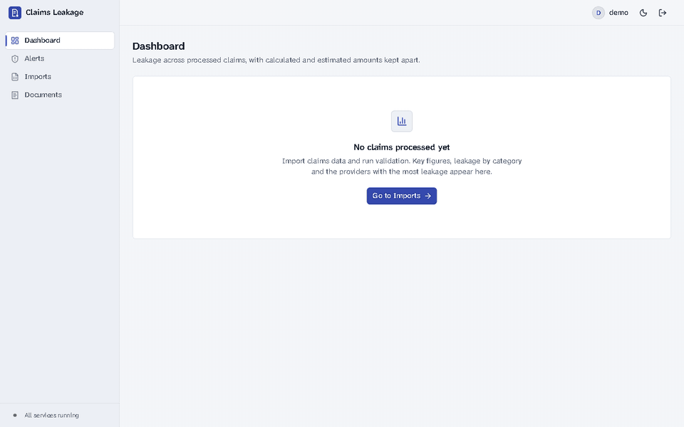
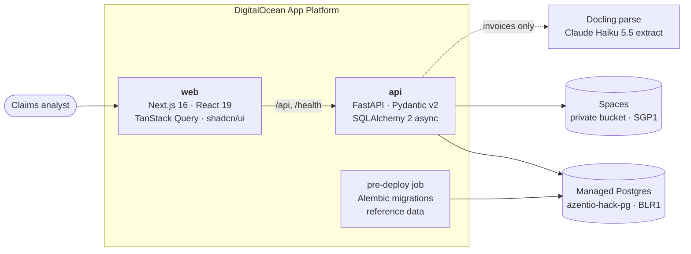
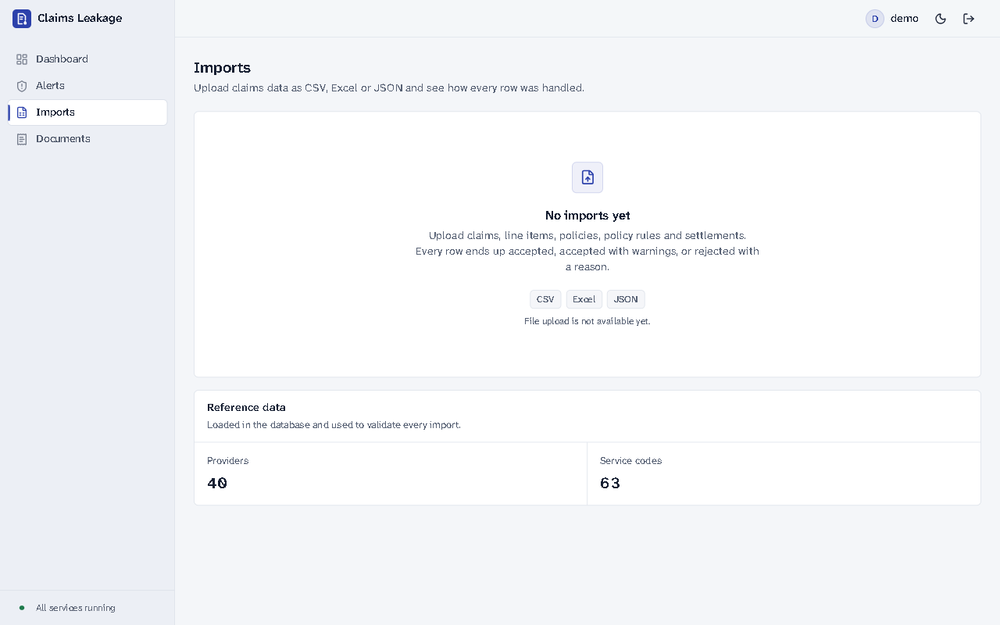
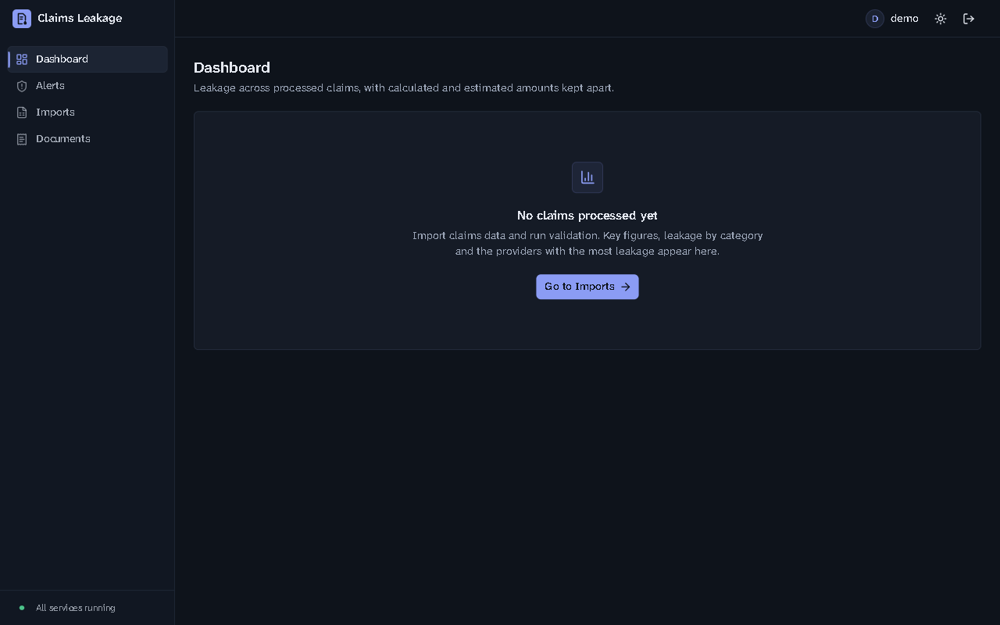

<div align="center">



<br>

<p>
  <a href="#quick-start"><b>Quick start</b></a> ·
  <a href="#how-it-works"><b>How it works</b></a> ·
  <a href="#what-it-catches"><b>What it catches</b></a> ·
  <a href="#roadmap"><b>Roadmap</b></a> ·
  <a href="docs/plan.md"><b>Plan</b></a> ·
  <a href="docs/decisions.md"><b>Decisions</b></a>
</p>

<p>
  
  
  
  
  
  
  
  
  
  
</p>

<p>
  
  
  
</p>

</div>

---

**Claims Leakage** reads an insurer's claims, policies and settlement history, checks every claim against the policy it was filed under, finds duplicates, and works out how much money is leaking: to the rupee where it can be calculated, and clearly marked as an estimate where it cannot.
Every alert shows the rule that fired, the formula with real values, and the source row each number came from.

> [!NOTE]
> Built at the Azentio.ai Build Labs hackathon (Bengaluru, October 2026) and under active development.
> The foundation (Phase 0) is done: the backend core, the full database schema, demo login, the app shell and the deploy spec.
> The [roadmap](#roadmap) tracks the rest, phase by phase.

<div align="center">
  
  <br>
  <sub>The app today: Dashboard, Alerts, Imports (63 service codes and 40 providers already loaded), Documents, dark mode, and the demo sign-in.</sub>
</div>

## Why it matters

Claims leakage is money an insurer pays that the policy never owed: a room billed above its daily cap, a co-pay nobody applied, the same invoice filed twice.
Each one is small and easy to miss in a spreadsheet, and together they add up.

Claims Leakage has three rules of its own:

| | |
| --- | --- |
| 🧮 **Deterministic money** | Every rule, duplicate check and rupee figure is plain, unit-tested Python. Money is `NUMERIC(12,2)` in Postgres and `Decimal` in Python, never a float. |
| 🔎 **Nothing unexplained** | Every result names the check, the policy rule ID and clause, the inputs used and the outcome. Every alert links back to the file, sheet and row behind it. |
| 🧾 **No silent drops** | Every input row ends up accepted, accepted with warnings, or rejected with a reason, and the counts must add up: `received = accepted + warnings + rejected`. |

AI is used for one job only: reading uploaded invoices. Its output then goes through the same validation as a CSV row.

## How it works



1. **Ingest.** CSV, Excel or JSON files (and invoice PDFs or scans) are parsed into staging rows. Headers are matched through a synonym map, so `Claim No`, `claim id` and `ClaimID` all land in `claim_id`.
2. **Validate.** Identifiers, dates (ambiguous ones are rejected, never guessed), Indian amount formats like `₹1,42,000`, and references across files are checked. A rejected claim takes its line items with it, with the reason recorded.
3. **Policy rules.** Each claim is run through checks C01 to C12 against a running policy ledger, so per-period sub-limits and the overall limit account for earlier claims. The payable amount is built step by step, from requested to payable.
4. **Duplicates.** Exact duplicate claims, repeated line items and near-duplicates are found by business attributes, not IDs. Legitimate repeats such as weekly physiotherapy are cleared, with the reason written down.
5. **Alerts.** Every failed check and every flagged duplicate becomes exactly one alert, with a category, a severity, an amount, an amount type and the formula.

### Anatomy of an alert



<sub>The alert format the plan specifies, using the organisers' room-rent example. The rule engine and alert pages ship in Phases 3 to 6.</sub>

### Architecture



The browser only talks to Next.js. `/api/*` and `/health` go to FastAPI on the same domain, so the httpOnly session cookie is first-party and no CORS is involved.
Processing is a staged pipeline of plain functions (ingest → validate → rules → duplicates → alerts), with no agent framework and no Redis. Background runs keep their status in the database.

## What it catches

<details open>
<summary><b>Policy rule checks (C01 to C12)</b></summary>
<br>

| Code | Check | Leakage when it fails |
| --- | --- | --- |
| C01 | Incident date inside the benefit period | Full requested amount |
| C02 | Claimant is an insured member of the policy | Full requested amount |
| C03 | Claim type has a coverage rule | Full requested amount |
| C04 | Line category or service code is covered | Line amount |
| C05 | Service matches an exclusion | Line amount |
| C06 | Daily rate within the per-day sub-limit | (rate − limit) × days |
| C07 | In-scope total within the per-claim sub-limit | Total − limit |
| C08 | In-scope total within what is left of the per-period sub-limit | Total − remaining |
| C09 | Deductible applied | Deductible (an adjustment) |
| C10 | Co-pay applied after the deductible | Co-pay % × amount (an adjustment) |
| C11 | Payable within the remaining overall limit | Payable − remaining |
| C12 | Settled claims: paid ≤ approved and ≤ recomputed entitlement | Paid − entitlement (overpayment) |

On open claims, deductibles and co-pays are normal policy application, so they are recorded but not alerted.
On settled claims, C12 compares what was paid with what was owed, so a missed co-pay shows up as a calculated overpayment: *"paid ₹84,000; entitlement ₹75,600; co-pay of ₹8,400 not applied."*

</details>

<details open>
<summary><b>Duplicate detection</b></summary>
<br>

| Pattern | How it is found | Amount |
| --- | --- | --- |
| **Exact duplicate claim** | Same claimant, provider and set of normalised invoice references, or same incident reference, date and amount | Calculated |
| **Duplicate line item** | Same service, date, quantity and price within a claim, or the same invoice line in another claim | Calculated |
| **Near-duplicate** | Weighted score from invoice similarity (`INV-00452` vs `INV452A`), date gap, amount gap and shared service codes; flagged at ≥ 0.80 | Estimated |
| **Legitimate repeat** | Repeatable service, minimum gap met, different invoices, within the weekly maximum | Cleared, with a reason |

</details>

<details open>
<summary><b>Amount types and severity</b></summary>
<br>

| Amount type | Meaning |
| --- | --- |
|  | Exact, from policy terms and claim records; the formula is shown |
|  | Likely, based on similarity to another record; needs review before any deduction |
|  | A pattern worth a look where no amount can be set |

Calculated and estimated leakage are always reported as separate figures, never one combined total.
Severity runs **Critical** (exact duplicate, or ≥ ₹50,000) → **High** → **Medium** → **Low** (under ₹2,000), plus **Review** for near-duplicates and excess frequency.

</details>

## Screenshots

<table>
  <tr>
    <td width="50%"></td>
    <td width="50%"></td>
  </tr>
  <tr>
    <td align="center"><sub><b>Imports</b>: accepted formats and the reference data used to validate every row</sub></td>
    <td align="center"><sub><b>Dashboard</b>: dark mode, before the first run</sub></td>
  </tr>
</table>

## Quick start

**Requirements:** Python 3.12 with [`uv`](https://docs.astral.sh/uv/), Node 22.12+ with [`pnpm`](https://pnpm.io/), and a local Postgres for tests (`createdb azentio_test`).

```bash
git clone https://github.com/PradeepKundekar0101/azentio-hack.git && cd azentio-hack

cp backend/.env.example backend/.env   # database URL, Spaces key, session secret, demo login
cd backend && uv sync && cd ../frontend && pnpm install && cd ..

make migrate seed-reference            # schema, then 63 service codes and 40 providers
make dev                               # backend on :8000, frontend on :3000
```

Open <http://localhost:3000>: signed out, you land on the public page (`/welcome`); sign in with `DEMO_USERNAME` / `DEMO_PASSWORD` from `backend/.env` to reach the dashboard.

<details>
<summary><b>Make targets</b></summary>
<br>

| Target | What it does |
| --- | --- |
| `make dev` | Backend on :8000 and frontend on :3000 |
| `make test` | Backend pytest and frontend vitest |
| `make lint` | ruff, ESLint and TypeScript checks |
| `make format` | ruff fix and format |
| `make migrate` | Alembic migrations against `DATABASE_URL` |
| `make seed-reference` | Load service codes and providers from `backend/reference/` (idempotent) |
| `make generate` | Synthetic input files and invoices under `data/sample/` |
| `make reset-demo` | Empty every table in the configured database, then reload reference data |
| `make api-types` | Regenerate the frontend's typed API client from the running backend |

</details>

<details>
<summary><b>Environment variables</b> (<code>backend/.env</code>)</summary>
<br>

| Variable | Purpose |
| --- | --- |
| `DATABASE_URL` | `postgresql+psycopg://…?sslmode=require` |
| `DB_POOL_MODE` | `session`, or `transaction` behind DO's PgBouncer pool |
| `SPACES_REGION`, `SPACES_ENDPOINT_URL`, `SPACES_BUCKET`, `SPACES_PREFIX` | Object storage location; every key is written under the prefix |
| `SPACES_ACCESS_KEY_ID`, `SPACES_SECRET_ACCESS_KEY` | Key limited to read/write on the bucket |
| `SESSION_SECRET` | Signs the session cookie (at least 32 characters) |
| `DEMO_USERNAME`, `DEMO_PASSWORD` | The shared demo login |
| `COOKIE_SECURE` | `false` for plain `http://localhost` |
| `CORS_ORIGINS` | Comma-separated; a fallback for local tools |

</details>

## Tests

```bash
make test   # pytest (backend) + vitest (frontend)
make lint   # ruff, ESLint, tsc
```

Backend tests run against a local Postgres (`TEST_DATABASE_URL`, default `postgresql+psycopg://localhost:5432/azentio_test`), rebuilt from the migrations at the start of each run and emptied before each test.
A few tests use the real DigitalOcean database and Spaces through `backend/.env`, and skip when it is missing.

The project is done when every row of the [acceptance test matrix](docs/plan.md#acceptance-test-matrix-and-demo-script) passes as an automated test against the synthetic data's answer key.

## Project structure

```text
azentio-hack/
├── backend/                 FastAPI app (Python 3.12, uv)
│   ├── app/
│   │   ├── api/             routes: auth, health, reference, pagination
│   │   ├── core/            config, logging, error format, money (Decimal + ₹ formatting)
│   │   ├── db/              async SQLAlchemy models and session
│   │   └── storage/         DigitalOcean Spaces client
│   ├── migrations/          Alembic
│   ├── reference/           service codes and providers (CSV)
│   ├── scripts/             seed_reference, reset_demo
│   └── tests/
├── frontend/                Next.js App Router (TypeScript, pnpm)
│   └── src/
│       ├── app/             (app)/ dashboard, alerts, imports, documents · login · welcome (landing) · share images
│       ├── components/      app shell, logo, shadcn/ui primitives, empty states
│       ├── lib/             typed API client, auth, ₹ formatters
│       └── styles/          theme.css (every colour token), brand constants, logo geometry, brand fonts
├── infra/                   App Platform spec and renderer
└── docs/                    plan.md, decisions.md, assets/
```

## Roadmap

Each phase ends with passing acceptance criteria and a commit tagged `phase-N`.

- [x] **Phase 0: Foundation.** FastAPI core, full schema migrated, Spaces client, ₹ money parsing, `/health`, demo login, app shell, deploy spec
- [ ] **Phase 1: Synthetic data.** About 3,000 claims and 12,000 line items in CSV, Excel and JSON, with planted leakage and an answer key
- [ ] **Phase 2: Ingestion and validation.** Upload, header mapping, row and cross-record validation, reconciliation, error report
- [ ] **Phase 3: Policy rule engine.** Checks C01 to C12, policy ledger, step-by-step payable, explanations
- [ ] **Phase 4: Duplicate detection.** Exact, line item, near-duplicate scoring, legitimate repeats cleared
- [ ] **Phase 5: Alerts.** Categories, severity, amount types, supporting records
- [ ] **Phase 6: Dashboard.** KPIs, charts, URL-backed filters, alert and claim drill-down, cleared tab
- [ ] **Phase 7: Document upload.** Docling + Claude extraction, review form, same validation as file rows
- [ ] **Phase 8: Hardening and demo.** Audit log, masked names, demo reset, fallback dataset

## Deployment

The app runs on DigitalOcean App Platform ([`infra/app-spec.yaml`](infra/app-spec.yaml)): `api` (the backend Docker image) and `web` (Next.js) on one domain, plus a pre-deploy job that runs migrations and loads reference data.
Secrets come from `backend/.env` and the deployment-only `.env.do` (both gitignored) through [`infra/render_spec.py`](infra/render_spec.py). The deployed demo login is different from the local one.

```bash
python3 infra/render_spec.py > "$TMPDIR/spec.yaml" && doctl apps create --spec "$TMPDIR/spec.yaml"
```

<details>
<summary><b>Infrastructure</b></summary>
<br>

All resources live in the DigitalOcean account `dev@getconch.ai`.

| Resource | Details |
| --- | --- |
| Postgres | Cluster `azentio-hack-pg` (Postgres 18, `blr1`), database `azentio`, user `azentio_app` (not a superuser) |
| Spaces | Bucket `leaklens-files` (`sgp1`, private), shared with LeakLens; this app only uses keys under `azentio-hack/` |
| Spaces key | `azentio-hack`, limited to read/write on `leaklens-files` |

Spaces is not available in BLR1 for this account, so claim documents are stored in Singapore. See [docs/decisions.md](docs/decisions.md).

</details>

## Documentation

| Document | What's in it |
| --- | --- |
| [`docs/plan.md`](docs/plan.md) | The full build plan: data contracts, schema, every check, duplicate scoring, API contract, demo script |
| [`docs/decisions.md`](docs/decisions.md) | Judgement calls and where the environment forced a change |
| [`backend/README.md`](backend/README.md) | Backend notes |
| [`frontend/README.md`](frontend/README.md) | Frontend notes |

## Contributors

<a href="https://github.com/PradeepKundekar0101/azentio-hack/graphs/contributors">
  
</a>

<div align="center">
<br>
<sub>Built at the Azentio.ai Build Labs hackathon, Bengaluru, October 2026.</sub>
</div>
